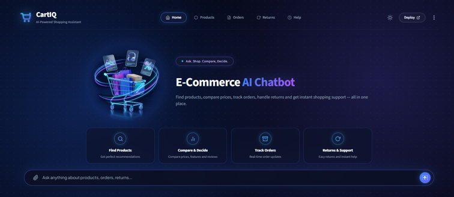

# 🛒 E-Commerce AI Chatbot

An intelligent chatbot for an online shoe store, powered by **Groq AI**, **ChromaDB**, and **Streamlit**. The bot can answer both general store policy questions and product-specific queries using natural language.


---

## 🤖 What It Does

Users can type questions in plain English and get smart answers:

| Question Type | Example | How It's Answered |
|---|---|---|
| **Policy / FAQ** | *"What is your return policy?"* | Searches FAQ knowledge base → AI generates answer |
| **Product Search** | *"Nike shoes under ₹3000?"* | AI converts to SQL → queries product DB → AI explains results |

---

## 🏗️ Architecture Overview

```
User Question
     │
     ▼
┌─────────────┐
│   main.py   │  ← Streamlit Chat UI
└──────┬──────┘
       │
       ▼
┌─────────────┐
│  router.py  │  ← Semantic Router (decides FAQ or Product)
└──────┬──────┘
       │
  ┌────┴─────┐
  │          │
  ▼          ▼
faq.py    sql.py
  │          │
  ▼          ▼
ChromaDB  db.sqlite
  │          │
  └────┬─────┘
       │
       ▼
   Groq AI  ← Generates final human-friendly answer
```

---

## 📁 Project Structure

```
app/
├── main.py                   # Entry point — Streamlit UI & routing logic
├── router.py                 # Semantic router (classifies user intent)
├── faq.py                    # FAQ handler using ChromaDB + Groq AI (RAG)
├── sql.py                    # Product handler using Text-to-SQL + Groq AI
├── db.sqlite                 # SQLite product database
├── .env                      # Environment variables (API keys)
└── resources/
    └── faq_data.csv          # FAQ knowledge base (10 Q&A pairs)
```

---

## ⚙️ How It Works

### 1. 🚦 Intent Routing (`router.py`)
Uses **Semantic Router** with a HuggingFace embedding model (`all-MiniLM-L6-v2`) to classify user questions into two routes:
- `faq` — for policy and general store questions
- `sql` — for product search and shopping queries

### 2. 🗂️ FAQ Answering — RAG Pipeline (`faq.py`)
1. At startup, loads `faq_data.csv` into **ChromaDB** (vector database)
2. On a user question, retrieves the **2 most semantically similar** FAQ entries
3. Passes them as context to **Groq AI** to generate a natural language answer

### 3. 🗄️ Product Search — Text-to-SQL Pipeline (`sql.py`)
1. Sends user question + database schema to **Groq AI** → generates an SQL query
2. Runs the SQL query against **`db.sqlite`** (product table)
3. Passes the raw results back to **Groq AI** → generates a human-friendly response

---

## 🗃️ Product Database Schema

```
Table: product

| Column        | Type    | Description                              |
|---------------|---------|------------------------------------------|
| product_link  | string  | URL link to the product page             |
| title         | string  | Name of the product                      |
| brand         | string  | Brand (Nike, Puma, Campus, etc.)         |
| price         | integer | Price in Indian Rupees (₹)               |
| discount      | float   | Discount (0.1 = 10%, 0.2 = 20%)         |
| avg_rating    | float   | Average rating (0–5 scale)              |
| total_ratings | integer | Total number of customer ratings         |
```

---

## 🛠️ Tech Stack

| Technology | Purpose |
|-----------|---------|
| [Streamlit](https://streamlit.io/) | Chat web UI |
| [Groq AI](https://groq.com/) | LLM for answer generation |
| [ChromaDB](https://www.trychroma.com/) | Vector database for FAQ search |
| [Semantic Router](https://github.com/aurelio-labs/semantic-router) | Intent classification |
| [HuggingFace `all-MiniLM-L6-v2`](https://huggingface.co/sentence-transformers/all-MiniLM-L6-v2) | Text embedding model |
| [SQLite](https://www.sqlite.org/) | Lightweight product database |
| [Pandas](https://pandas.pydata.org/) | Data handling |
| [python-dotenv](https://pypi.org/project/python-dotenv/) | Environment variable management |

---

## 🚀 Getting Started

### Prerequisites
- Python 3.10+
- A [Groq API Key](https://console.groq.com/)

### 1. Clone the Repository
```bash
git clone <your-repo-url>
cd app
```

### 2. Install Dependencies
```bash
pip install streamlit groq chromadb sentence-transformers semantic-router pandas python-dotenv
```

### 3. Set Up Environment Variables
Create a `.env` file in the `app/` directory:
```env
GROQ_API_KEY=your_groq_api_key_here
GROQ_MODEL=openai/gpt-oss-20b
```

> ⚠️ **Never commit your `.env` file to version control.** Add it to `.gitignore`.

### 4. Run the App
```bash
streamlit run main.py
```

The app will open in your browser at `http://localhost:8501`

---

## 💬 Example Conversations

**Policy Questions (FAQ):**
```
User:  What is your return policy?
Bot:   You can return products within 30 days of delivery.

User:  What payment methods do you accept?
Bot:   We accept credit/debit cards, net banking, UPI, and cash on delivery.
```

**Product Questions (SQL):**
```
User:  Do you have Nike shoes under ₹3000?
Bot:   1. Nike Air Max: Rs. 2499 (20% off), Rating: 4.3 <link>
       2. Nike Revolution: Rs. 2799 (15% off), Rating: 4.1 <link>

User:  Show me Puma shoes on sale.
Bot:   1. Puma Softride: Rs. 3199 (30% off), Rating: 4.5 <link>
```

---

## 📋 FAQ Knowledge Base

The bot knows answers to the following topics (stored in `faq_data.csv`):

- 🔄 Return policy
- 💳 HDFC credit card discount
- 📦 Order tracking
- 💰 Accepted payment methods
- ⏱️ Refund processing time
- 🏷️ Ongoing sales and promotions
- ❌ Order cancellation / modification
- 🌍 International shipping
- 📦 Damaged product policy
- 🎟️ Promo code usage

---

## 🔒 Security Notes

- The `.env` file contains your API key — **never share or commit it**
- The SQL handler only allows `SELECT` queries — no data modification is possible
- AI answers for FAQs are grounded in context only — the bot is instructed to say *"I don't know"* if the answer isn't found

---

## 📌 Key AI Concepts Used

| Concept | Description |
|---------|-------------|
| **RAG** (Retrieval-Augmented Generation) | Retrieve relevant FAQ entries first, then generate an answer |
| **Text-to-SQL** | Convert plain English questions into SQL database queries using AI |
| **Semantic Routing** | Route questions based on *meaning*, not just keywords |
| **Vector Embeddings** | Text converted to numbers so similarity can be measured mathematically |

---

## 📄 License

This project is for educational purposes as part of a **Gen AI Business Project**.


